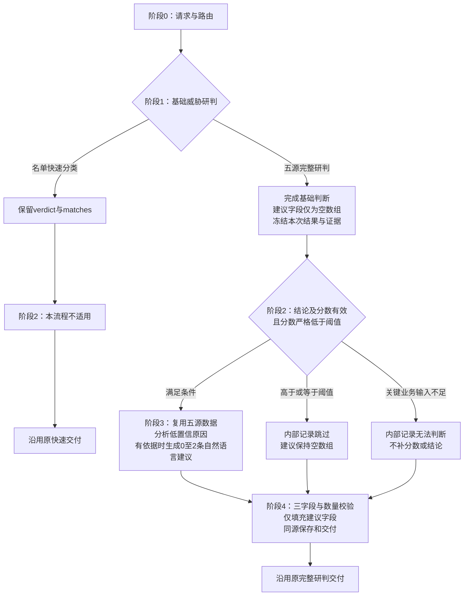

# 规则优化建议

所属智能体：网络安全运营专家（`security-operations-expert`）  
日期：2026-11-06  
状态：已确认的新版设计；本文保存不代表业务代码、Case或实例已经按此更新。

本文根据前期第三章及改进讨论，独立维护新版规则优化建议设计。前期资料保留为来源；其“误报/可疑全部触发”“高置信度例外”“生成完整规则JSON”“公开最多一条”等旧要求，不作为本设计的现行要求。本文保留阶段0、1、2的核心职责，细化阶段1的建议占位及阶段2门槛；旧阶段3—8不再沿用，改为新的阶段3、4。

## 目标与边界

在基础威胁研判完成后，只对满足严格低置信度门槛的完整研判结果，复用本次事件已经取得的五源数据，分析低置信度原因是否与规则有关。有充分依据和具体调整方向时，输出自然语言规则优化建议；没有依据时可以不产生建议。

本流程：

- 仍使用同一Agent，保留基础研判与条件式后置建议两个模型阶段；不要求两个阶段使用不同模型，不新增独立Agent。
- 不在基础研判阶段先生成建议、再让后置阶段覆盖；后置阶段是最终建议的唯一生成来源。
- 不生成SOC可执行DSL、完整规则JSON、正则/SQL/SIGMA实现代码或规则文件，不创建、修改、采用、启停或执行规则。
- 不为提出建议重新进行五源取证，不自动扩展全库规则查询、完整定义批量读取、正文编译、规则试跑或效果回放。
- 不改变基础研判的结论、分数、事实、反向证据、处置建议、原校验或交付状态。基础阶段冻结后，只允许填充原有建议字段。
- 不以单个事件证明总体误报下降、召回改善或变更安全；规则维护方负责后续实现与独立效果验证。

## 对外输出合同

### 字段与数量

完整研判结果继续使用 `rule_optimization_suggestions`，类型为数组，允许0、1、2项，最多两项。每项必须且只能包含以下三个字段：

| 字段 | 类型 | 含义与要求 |
| --- | --- | --- |
| `rule_level` | 字符串 | 规则层级，只能为“检测规则”或“关联规则”；不能把同一项写成两个层级 |
| `suggestion` | 非空字符串 | 自然语言说明本案问题、依据和具体调整方向；区分已经确认的问题、合理推论与待核查事项，不含可执行规则正文 |
| `impact_scope` | 非空字符串 | 说明涉及的规则或行为、对象和适用范围，以及可能损伤的信号、误漏报风险和未验证边界；未知部分如实说明 |

规则如下：

1. 不要求检测与关联各一条；两条可以属于同一层级，但不能重复表达同一个问题。
2. 生成时优先选择本案证据充分、问题和调整方向明确、影响边界清楚的方向，最多提出两项，不为凑数量产生建议。原始回执超过两项时整包拒收，不通过筛选、排序或截取两项规避上限。
3. 没有具体建议时返回 `[]`。不能返回空对象、空字符串、null条目，或把“暂无建议/取证失败”包装成一条建议。
4. 不再使用旧的 `rule_content`、`cannot_optimize_reason` 或嵌套 `rule` 对象；不增加规则ID、证据列表、评分和运行状态等第四个公开字段。
5. 已知的规则名称或业务ID可以在自然语言中说明；缺少时不得编造。目标绑定、证据引用、门槛及处理状态保留在模型外审计中。
6. JSON仅是基础结果的传输容器，不是SOC可直接执行的规则JSON。具体业务建议本身使用自然语言。

### 结构示意

以下仅说明字段结构，字符串是占位说明，不代表本次已经发现相应规则问题；实际输出不能照抄泛化句。

```json
{
  "rule_optimization_suggestions": [
    {
      "rule_level": "检测规则",
      "suggestion": "基于本次事件已核实的行为和上下文，说明具体问题及建议调整方向。",
      "impact_scope": "说明涉及的检测行为、对象、适用范围，以及可能的误报或漏报风险和未验证边界。"
    },
    {
      "rule_level": "关联规则",
      "suggestion": "基于本次事件已核实的实体与时序关系，说明事件组合中可考虑的具体调整方向。",
      "impact_scope": "说明涉及的事件组合、实体关系及可能被拆分或遗漏的场景，不声称已完成效果验证。"
    }
  ]
}
```

无建议时，完整研判结果中的同一字段为：

```json
{
  "rule_optimization_suggestions": []
}
```

以上对象只展示基础结果中的相关字段，不是新的完整研判顶层结构。名单快速分类继续仅使用原有 `verdict + matches`，不添加建议字段。

## 整体流程



阶段3中的原因分析与建议生成使用一次后置模型调用，不再拆为额外模型阶段。未满足阶段2门槛时，不为本建议分支启动模型调用或新增规则取证。

## 阶段0：请求与路由

### 输入与处理

- 从真实用户请求提取唯一合法威胁事件ID，沿用现有 `threat-analysis` 路由及 `delegate_threat_analysis` 委派，不在主Agent重复拼装规则查询。
- 用户的背景说明、人工标签、预设结论和“请优化规则”等意图，不作为本案已发生事实或规则缺陷标签。
- 请求只决定是否按现有入口办理基础研判，不能替代阶段2的低置信度判断。

### 输出边界

保留原请求、事件身份及路由。内部若保留“允许评估规则分支”的标记，它只表示允许阶段2作判断，不表示已经触发，也不是新增公开业务字段。

**本流程不保留人工指定、规则异常或默认开启绕过严格低置信度门槛的例外。** 不为满足建议请求降低基础分数、改变结论或把快速分类伪装成完整研判；本设计也不另建绕行入口。

## 阶段1：基础威胁研判

### 职责保持不变

模型外取证和名单快速分类先行。只有名单完整、存在直接实体单侧命中时走快速分类；双侧命中、未命中或查询不完整时走原完整研判。快速与完整分支互斥。

- 快速分类不调用基础模型，保留原有 `verdict + matches` 及取证、保存合同。
- 完整研判使用本次 `event_snapshot` 与五源 `enriched_context`，模型只依据冻结输入作基础判断，不调用工具。
- 保留基础研判原有结论、事实、主张、反向证据、不确定性、攻击链说明、处置建议和推理摘要等其他字段及原校验口径。

### 建议字段仅占位，不生成建议

阶段1完整结果保留 `rule_optimization_suggestions`，但必须是 `[]`：

- 基础提示词不再要求生成规则建议；不能沿用旧模板中的建议生成示例。
- 宿主在基础结果冻结前保证该字段为空。若原始模型回执仍带非空建议，不将其采用为基础或最终建议，并保留原始回执及偏差记录；不通过采纳该内容绕过阶段2。
- 对这一字段的占位处理不改变其他基础字段，也不把基础格式失败改成通过。
- 冻结后不让建议分析反向修改基础结论或分数，不依赖最终覆盖来掩盖基础阶段仍在生成建议的问题。

由此，后置阶段是建议唯一生成点；阶段4只是填充此前为空的字段，不是覆盖另一份已生成的基础建议。

## 阶段2：严格低置信度触发门槛

### 触发条件

同时满足以下条件，才进入阶段3：

1. 本次来源可确认是五源完整研判分支，不是名单快速分类，也不是由其他材料拼出的假完整结果。
2. 能核对本事件的基础结果和身份；结论为“误报”“可疑”或“真实告警”之一。
3. `confidence_score` 是 `[0,1]` 内有效、有限数值；不将布尔、字符串、空值或非有限值隐式转换。
4. 实际分数严格低于本次使用的阈值 `T`。

首版沿用可配置工作阈值 **`T=0.75`**。它不是经过独立样本校准的最优值；每次运行保留实际使用值，比较期间不得悄然更改。0.74进入，0.75及以上不进入。

“完整研判”指五源完整研判模式，不要求五个域全部非空或 `data_completeness=1`。基础格式校验状态不是门槛总开关；其他字段的机械格式问题不自动否定已经可用的事件身份、结论和分数。没有可辨认的基础结论或分数时，应记录无法判断，不伪造基础结果。

### 各类结果统一按分数处理

| 情形 | 是否进入阶段3 | 最终建议字段或原结果 |
| --- | --- | --- |
| 完整研判，误报、可疑或真实告警，分数低于T | 是 | 由阶段3决定是否形成建议，可能仍为 `[]` |
| 完整研判，任一种结论，分数等于或高于T | 否 | 建议保持 `[]` |
| 结论、分数、阈值或结果来源不可确认 | 无法判断，不进入 | 建议保持 `[]`，独立记录具体缺口 |
| 名单快速分类 | 本流程不适用 | 保持原有快速结果，不增加建议字段 |

高置信误报不再因“误报”标签自动触发；可疑也不再无条件触发。已有规则异常、人工指定和允许评估分支的标记，均不能覆盖上述严格条件。

`confidence_score` 表示当前结论的可信程度，不是恶意概率或规则质量分。`data_completeness` 是技术采集完成度，不能替代置信度。低置信误报不等于已确认良性，低置信真实告警也不等于应硬改规则提高分数。

## 阶段3：低置信原因分析与自然语言建议

### 输入与处理边界

复用阶段1已经取得并冻结的材料：

- 本事件身份、对象、时间范围及五源可用业务数据和原始引用。
- 基础结论、置信度、已取得事实、关键主张、反向证据和不确定性。基础模型摘要仅为有来源的参考，不作独立真值。
- 已有的相关规则身份、用途、案内命中和当前条件等信息，用于必要对照。
- 真实的来源、采样、裁剪、空查询、失败、同源重复及时间口径说明。

不重新执行五源研判，不让第二模型自行调用MCP，不因建议生成扩大全库查询或要求所有完整规则定义先行齐备。仍使用经确认的资源预算，不以本设计自动追加调用、上下文或验证额度。

实现时直接复用本轮同一份冻结五源，不再次裁剪或重组其中的业务证据，不额外读取审计文件拼装后置模型输入。已冻结的基础结论、分数、不确定性及其他基础归纳仅作参考；冻结材料没有说明的缺口原因保持未知，不补猜。模型外仍可读取必要的事件与摘要元数据完成一致性核验，但不把这些运行元数据当作新的业务证据。

五源解释本案发生了什么，不能单独证明规则当前配置了什么。要断言“当前规则缺少某条件、采用了某种计数或发生了特定求值错误”，必须有相应当前规则或命中依据；依据不足时，不能把待核查假设写成确认缺陷。已有信息能够支持具体且有条件的维护建议时，可说明需要核查的规则维度，但不能只给泛化口号。

本流程面向本事件涉及的SOC检测规则和关联规则。外部EDR告警可以作为事件证据，但不能仅因其在SOC可见，就把外部规则冒充SOC自有检测规则或猜造SOC规则ID。

### 先归因，再决定是否给建议

| 低置信度的主要原因 | 判断与处理 | 是否形成规则建议 |
| --- | --- | --- |
| 告警或日志未读全、字段缺失、接口失败、抽样/裁剪、时间范围不对应 | 明确取证或数据质量缺口，说明其影响 | 不能直接包装为规则修改；没有其他充分依据则为 `[]` |
| 已有事实支持实体混入、同源重复计数、条件组合或时序关系影响区分 | 对照相关规则用途及已有命中，明确具体问题与调整目的 | 有依据、方向具体且能说明影响时，才形成建议 |
| 存在相互冲突的事实或未确定的业务解释 | 区分已证事实、合理推论和待核查事项 | 能形成有条件的具体方向时可以建议；不猜授权、不凭空加白名单 |
| 只有分数低，没有可对应到规则的原因，或没有合理改法 | 明确本次无充分修改依据 | 返回 `[]`，不为凑数量产出 |

原因可以并存；一个分支或数据域缺失，不连坐否定其他已有充分依据的具体方向。反过来，进入门槛或取到数据，也不等于必须提出改动。

### 五源的使用维度

| 数据域 | 优先使用的已取得事实 | 可考虑的规则维度 | 不能直接推断的事 |
| --- | --- | --- | --- |
| `edr_detail` | 进程与命令、实际父子关系、账户/会话、对象、时间及原生结果；只用真实非空字段 | 行为语义和匹配范围、上下文区分、同一进程链或会话、尝试与结果的区别 | 常见工具或只读命令不等于获授权；进程创建或会话标识不等于攻击或登录成功 |
| `graph` | 确有数据的实体关系、端点、账户、登录或流量关联；拓扑仅作其已知时点上下文 | 稳定实体绑定、事件组合、通信方向、关系及时序 | 可达不等于连接发生，拓扑邻居不等于横向移动；空占位不证明没有活动 |
| `asset` | 已核资产身份、角色、业务归属及其他真实返回的上下文 | 对象归属、适用场景和业务边界 | 重要性不是恶意，资产标签不是授权证明，查询时状态不自动代表事件发生时状态 |
| `threat_intel` | 本次实际查询的指标、命中性质、对象、来源及真实提供的时效信息 | 情报相关性、辅助证据权重和对象一致性 | 未命中或查询失败不等于良性；白名单、恶意命中等性质不能混淆 |
| `history` | 真正取到且来源、对象、时段及复核状态可核对的历史记录 | 同类活动差异、重复升级和有依据的历史反馈 | 没取到历史不等于无先例；旧模型结论不当独立人工真值，不编造长期误报率或正常基线 |

五源是组织域，不是五份独立证据。同一原始告警在不同域及摘要中重复出现，只能按实际来源与记录核对，不能重复增加权重。当前核查资料中的历史域和部分关系数据存在缺口，是否可用应以本次实际输入为准，不把合同中的容器存在当作数据已经取得。

总体可考虑行为匹配、实体绑定、时间顺序/窗口、去重聚合、证据权重、资产业务边界和情报/历史上下文等维度；不是每次逐维度各产一条，也不在没有分布依据时随意指定新窗口、阈值或白名单。

### 自然语言建议的质量要求

- `suggestion` 要解释本案依据、具体问题及调整方向，不能只写“提高准确率”“结合上下文”或“增加白名单”。
- 明确检测层还是关联层。事件被判误报，不代表全部底层检测信号都有缺陷；规则有意记录弱信号，也不等于它必须证明攻击成功。
- 没有对应依据时，不把“缺少多阶段或成功结果条件”自动当缺陷，不强加与规则用途不同的新目标。
- `impact_scope` 说明已知范围、可能丢失的信号和未验证风险，不声称已经降噪、补漏报或完成依赖闭包分析。
- 层级和对象不能合理确定、没有具体改进方向或不能解释其边界时，不填占位建议。

## 阶段4：校验、合并与同源交付

### 校验范围

先作包级校验：严格解析JSON，拒绝坏JSON、重复键及非有限值，并核对封套、同案身份和原始items数组至多两项；任一包级失败整包拒收，不先过滤坏项再计数。包级通过后逐项独立核对字段、层级、非空字符串、私有来源引用和重复方向；“只提供自然语言优化建议”通过生成提示约束，不按代码词形拒收，不另建替代内容检测机制；只保留各自通过的项，单项失败不连坐其他项。重复方向保留先通过校验的项，拒收后续重复项。公开条目仍恰为rule_level、suggestion、impact_scope，不补造或改写原值。结构合法不等于语义有依据，仍须按本案原始材料复核事实、具体性和风险。

不执行SOC规则正文校验、编译、启停、回放或写规则。旧方案的完整规则格式校验，不再是自然语言建议的前置条件。不能通过补造字段、重写事实或扩展权限使输出看似合格。

### 合并与保存

1. 只把阶段3生成并符合新合同的数组填入完整基础结果的 `rule_optimization_suggestions`。
2. 未触发、没有具体建议或没有可交付建议时，该字段保持 `[]`；不回退采用阶段1的旧建议，不把故障诊断当建议项。
3. 基础其他字段及原校验状态保持不变。无法合法绑定基础容器时，不伪造一份成功的完整研判结果。
4. 最终结果、报告和SOC研判写回使用同一份建议数组，展示自然语言内容及层级/影响范围；不重新生成不同版本。
5. 门槛未触发、条件无法判断、数据不足、没有合理改动、生成失败、包级全拒、逐项全拒和部分采纳分别记录。合法空建议须有具体原因；非空回执全部拒收仍是校验失败，不得等同于合法无建议。逐项结果、原始位置、采用与拒收数量及具体拒因保留在私有审计；部分采纳在阅读交付中明确采用与拒收数量和安全原因类别，不公开被拒原文或证据引用，不向公开建议条目添加字段。`[]` 本身不证明规则无需优化或建议阶段成功，必要失败说明不能被空数组掩盖。
6. 仍沿用原研判及报告保存合同；保存成功不代表建议有效、规则已经修改或效果通过。已完成Run保留原值，不追溯改写。

## 实施与验证边界

本文替代的是旧规则建议分支设计，不是已实施回执。后续实现至少需对齐：

- 基础提示词和宿主输出投影：阶段1建议固定为空，不再允许双处生成。
- 业务门槛：所有完整研判结论统一严格低置信度，取消旧标签直通和高置信度例外。
- 后置提示词、输入组织、结果提取及校验：改为基于五源归因的自然语言三字段、最多两项。
- 报告、SOC保存及恢复路径：使用同一新合同；旧格式只按历史读取需要处理，不把已完成记录迁移成新运行。

新实现应核对严格阈值边界、快速分支不增字段、缺关键输入不猜值、低分但无规则问题可为空、有依据时最多两条具体建议，以及基础其他字段不变等要求。具体Case仍在Agent共用[评测口径](../../evaluation.md)维护，后续Run冻结本次输入与口径；本文不另建Case编号台账，也不以文档或静态检查替代真实运行结果。

本次仅保存设计文档，未改业务源码、配置、Case、实例、MCP或历史Run，未追加模型调用、SOC操作或评测预算。

## 来源与适用关系

- [前期设计第三章](</opt/Coding/威胁研判后续开发.md#L96-L509>)：保留阶段0、1、2的职责背景。其旧阶段3—8、旧输出及门槛例外不再作为本设计的现行要求。
- [调整建议中的低置信原因归类](</opt/Coding/SOC规则优化建议调整建议.md#L225-L236>)及[五源数据边界](</opt/Coding/SOC规则优化建议调整建议.md#L238-L279>)：仅借鉴数据、归因和风险原则，不沿用其中此前推荐的高置信度例外或其他旧载体提案。
- [本轮核对的基础提示词:58–79](<../../../../evolution/experiments/EXP-security-operations-expert-027-m-reab20c48f610/candidate/dsh/managed/threat-analysis/prompts/threat-analysis-system.txt#L58-L79>)与[后置接线:225–267](<../../../../evolution/experiments/EXP-security-operations-expert-027-m-reab20c48f610/candidate/dsh/managed/threat-analysis/dsh_runner.py#L225-L267>)：用于定位需要对齐的生成与合并调用方，不据此宣称新方案已部署或所有实例均装载同一版本。

原来两份资料不在本次修改范围内；新设计以本文为准。
